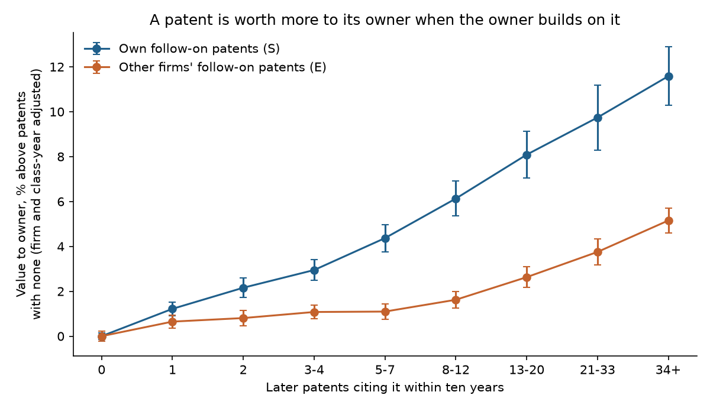
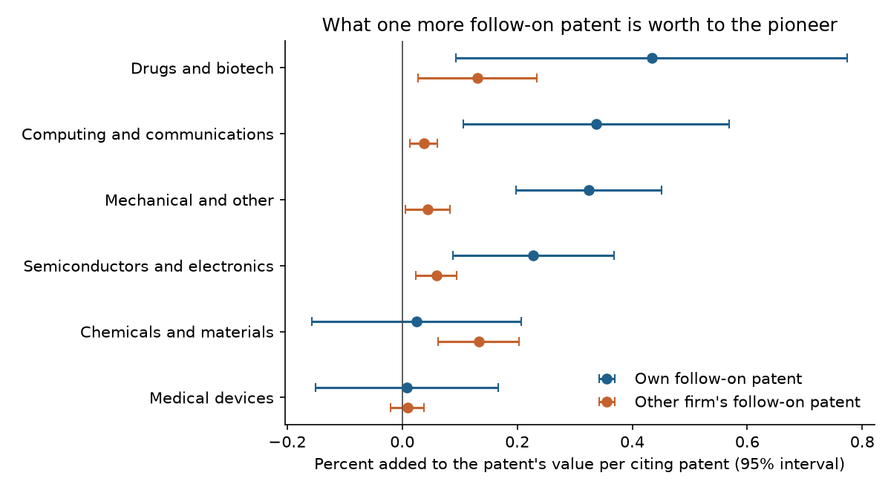

# The Pioneer's Share

### In 1995, Jerry Green and Suzanne Scotchmer asked how the profit from an invention is divided when someone else builds the next one on top of it. I asked again, with 1.2 million American patents and the stock market's valuation of each.

---

On most flat-panel screens, every pixel is switched on and off by its own thin-film transistor. On December 9, 2008,
the US Patent Office granted Hewlett-Packard patent 7,462,862, "Transistor using an isovalent semiconductor oxide
as the active channel layer." In the ten years that followed, 2,891 later American patents cited it as prior art.
Not one of them belonged to HP, and 2,880 belonged to a single company, Semiconductor Energy Laboratory of Atsugi,
Japan. Canon received a patent the same month on a method of making oxide semiconductor devices. It drew 2,904
citing patents in ten years, 2,886 of them from Semiconductor Energy Laboratory and three from Canon.

Each citation marks a later invention that, in the applicant's or examiner's view, built on HP's or Canon's. If HP's transistor helped make better screens possible, the profit from those screens went to
the companies that made them, and HP's share depended on whether its patent covered their work, whether they
needed a license, and how hard each side could bargain. Economists call this the problem of cumulative
innovation, and Jerry Green and Suzanne Scotchmer wrote one of the papers that set its terms.

---

## Two measures

The first measure is a patent's private value to its owner. Leonid Kogan, Dimitris Papanikolaou, Amit Seru and
Noah Stoffman (KPSS) estimated it for every patent granted since 1926 to a company listed on an American stock
exchange, from the part of the owner's stock move over the three trading days from the grant date that the
patent explains.

```math
\xi_j = \frac{1}{1-\bar{\pi}}\,\cdot\,\frac{1}{N_j}\,\cdot\,\mathbb{E}\!\left[v_j \mid R_j\right]\cdot M_j
```

Here $`R_j`$ is the firm's three-day return net of the market; $`v_j`$ is the part of it due to the patent; $`M_j`$ is the company's stock-market value the day
before; $`N_j`$ is the number of patents it received that day, which share the news; and $`\bar{\pi}`$ is the
probability that an application succeeds, which the market had already priced in. KPSS report values in 1982–84
dollars, which I restate in 2024 dollars with the consumer price index. HP's transistor patent was valued at

```math
\xi_{7{,}462{,}862} = \$11.57\text{M in 1982-84 dollars} \times \frac{313.689}{100} = \$36.3\text{ million (2024)}
```

and the median patent in my sample at $8.98 million.

The second measure is how much of the later work that builds on a patent is done by the patent's own owner. For
patent $`i`$, $`S_i`$ counts the later patents owned by the same company that cite it within ten years of its
grant, and $`E_i`$ counts the later patents owned by anyone else. Across the sample,

```math
\frac{\sum_i S_i}{\sum_i (S_i + E_i)} = \frac{2{,}660{,}440}{13{,}537{,}728} = 19.7\%
```

so about one follow-on patent in five belongs to the pioneer itself. HP's transistor patent had $`S = 0`$ and
$`E = 2{,}891`$.

The quantity Green and Scotchmer's argument turns on is the ratio of what an outside follow-on patent is worth to
the pioneer to what one of its own is worth. I call it $`\lambda`$ and estimate it below.

| Value of λ | What it means for the pioneer | Where it comes from |
|---|---|---|
| 1 | Gains as much when a rival builds on its patent as when it builds itself | Licensing that transfers all the follow-on profit |
| 1/2 | Keeps half of what an outside improvement adds | Green and Scotchmer's even bargaining split |
| 0 | Gains nothing from outside improvements | No license, no infringement, or full competition |

A negative value would mean outside improvements actively erode what the pioneer had.

---

## Green and Scotchmer's question

Jerry Green has taught economics at Harvard since 1970, chaired its department in the mid-1980s and served as the
university's provost from 1992 to 1994, and he wrote the standard graduate textbook in microeconomic theory with
Andreu Mas-Colell and Michael Whinston. Suzanne Scotchmer grew up in Pelican, a town of about 130 people
in Alaska, took her doctorate at Berkeley in 1980 and joined Harvard's economics department. She returned to
Berkeley's school of public policy in 1986 and became a professor of economics there in 1995 and of law in 2008.
Her 1991 essay "Standing on the Shoulders of Giants" asked how rewards should be divided when a series of
inventors develops a technology, and her 2004 book *Innovation and Incentives* surveyed the field. She died in January 2014, at 64.

Their paper, "On the Division of Profit in Sequential Innovation," appeared in the *RAND Journal of Economics* in
the spring of 1995. It imagines a first firm that can invent a product of quality $`x`$ at cost $`c_1`$, which
makes possible an improved product of quality $`x + y`$ that a second firm can develop at cost $`c_2`$. Profit over
the patent's life $`T`$ is $`\pi_x(T)`$ if the first product is sold alone by a monopolist and $`\pi_{x+y}(T)`$ if
the improved product is. The firms can sign a license after the second firm has its idea but before it spends anything,
splitting the gain from agreeing evenly.

Suppose the improvement would infringe the first patent, so without a
deal the second firm does not develop it and earns nothing, while the first earns $`\pi_x - c_1`$. A deal lets the
improved product be sold by one licensed seller, for joint profit $`\pi_{x+y} - c_1 - c_2`$. The even split gives
the first firm

```math
\begin{aligned}
u_1 &= d_1 + \tfrac{1}{2}\big[(\pi_{x+y} - c_1 - c_2) - d_1 - d_2\big] \\
    &= (\pi_x - c_1) + \tfrac{1}{2}\big[\pi_{x+y} - \pi_x - c_2\big] \\
    &= (\pi_x - c_1) + \tfrac{1}{2}\,\Delta, \qquad \Delta \equiv \pi_{x+y} - \pi_x - c_2 \\
u_1^{\text{one firm}} &= (\pi_x - c_1) + \Delta \;>\; u_1 \quad \text{whenever } \Delta > 0
\end{aligned}
```

where $`d_1 = \pi_x - c_1`$ and $`d_2 = 0`$ are the two firms' payoffs without a deal and $`\Delta`$ is the extra
profit the improvement creates. In plain English, a pioneer that does its own follow-on work keeps all of the
improvement's profit, and a pioneer that has to bargain with another firm keeps half of it. If an outside
follow-on invention creates on average the same extra profit $`\Delta`$ as one the pioneer makes itself, the
pioneer gains half as much from it, which is where the $`\lambda = \tfrac{1}{2}`$ in the table above comes from.

Proposition 1 states this generally. Whatever the patent's breadth, the first firm's profit is never more than
$`\pi_{x+y}(T) - (c_1 + c_2)`$, and for some improvements it is less, because the second firm can threaten to
compete with a non-infringing product, to invest and negotiate afterward, or not to invest at all. If a patent
lasted just long enough for the joint profit to cover both firms' costs, the first firm would not invest, so
patents must last longer when different firms do the two stages of research than when one firm does both. They also showed that broad first patents protect the
pioneer when the value and cost of improvements are known in advance, and that allowing licenses after costs are
sunk raises the pioneer's share.

The strongest objection came the same year from Teyu Chou and Hans Haller, then at Virginia Tech, who argued that
when patents are uncertain in court and the patent holder makes the licensing offer, the basic researcher can
extract essentially all the profit its invention makes possible over a wide range of conditions. On their account
$`\lambda`$ should be close to 1, and on Green and Scotchmer's it should be well below it. Patent length, patent
breadth and antitrust rules on licensing all depend on which account is closer to the truth.

---

## How I tested it

The paper has no data, so the test is mine, built on its sharpest prediction, that a pioneer gains less from an
improvement made by another firm than from one it makes itself. I took every patent granted from 2000 to 2014 to
a company with a KPSS value, 1,238,587 patents held by 4,451 firms, and matched them to the US Patent Office's
complete citation file as published by PatentsView, 145.9 million citations from one patent to another. For each
patent I counted citing patents granted within ten years, which is why the sample ends in 2014, and split them by
owner. A citing patent counts as the pioneer's own when KPSS match both patents to the same listed company,
which folds subsidiaries into parents.

The estimating equation compares patents held by the same firm and patents in the same technology class granted
in the same year.

```math
\begin{aligned}
\log \xi_i &= \beta_S\, S_i + \beta_E\, E_i + \alpha_{f(i)} + \delta_{c(i),\,t(i)} + \varepsilon_i \\
\lambda &= \beta_E / \beta_S, \qquad H_0^{a}\!: \lambda = 1, \qquad H_0^{b}\!: \lambda = \tfrac{1}{2}
\end{aligned}
```

Here $`\alpha_f`$ is a firm effect that absorbs everything permanent about a company, including its size and how
its stock is listed, and $`\delta_{c,t}`$ is an effect for each four-character CPC technology class and grant year,
which absorbs differences in how often patents in a field cite each other. $`\beta_S`$ and $`\beta_E`$ are the
proportional increases in a patent's value for each additional own and outside follow-on patent. Standard errors
are clustered by firm, and the interval for $`\lambda`$ uses the delta method. Counts are top-coded at the 99.9th
percentile, 152 for own and 317 for outside follow-on, so that a few patents with thousands of citations do not
drive the slopes. I set these rules before estimating, with one exception described below, and then varied each.

---

## An outside improvement is worth about a fifth as much to the pioneer as its own

Each additional patent the owner builds on its own patent goes with about 0.2% more value for the patent. Each
additional patent built on it by another firm goes with about 0.035% more.

```math
\begin{aligned}
\hat{\beta}_S &= 0.195\%\ (0.065), \qquad \hat{\beta}_E = 0.035\%\ (0.010) \\
\hat{\lambda} &= 0.181, \qquad 95\%\ \text{CI}\ [0.056,\ 0.307], \qquad N = 1{,}238{,}587 \\
p\,(\lambda = 1) &= 0.010, \qquad p\,(\lambda = \tfrac{1}{2}) = 0.040
\end{aligned}
```

At the median patent, worth $8.98 million, an own follow-on patent is associated with about $17,500 of value to
the pioneer and an outside one with about $3,200. The data reject full capture, as Green and Scotchmer predicted,
and they also reject the even split. The pioneer appears to keep less than half of what outsiders add.



The figure shows value by bins of follow-on, relative to patents with none, net of firm and class-year effects.
A patent the owner built on 34 or more times is
worth 11.6% more than one the owner never built on. A patent other firms built on 34 or more times is worth 5.2%
more, even though outside follow-on is four times as common.

| Version of the test | λ | 95% interval |
|---|---|---|
| Main: firm and class-year effects | 0.181 | 0.056 to 0.307 |
| Firm effects for each five-year period | 0.225 | 0.026 to 0.424 |
| "Own" defined by Patent Office assignee | 0.185 | 0.047 to 0.322 |
| Counts top-coded at the 99th percentile | 0.131 | 0.064 to 0.198 |
| Comparing across firms, class-year effects only | 0.306 | 0.196 to 0.416 |
| Value in dollars instead of logs | 0.330 | −0.106 to 0.766 |
| Only citations within three years | 0.668 | 0.112 to 1.224 |
| Only citations added by applicants | 0.018 | −0.194 to 0.229 |
| Grants 2000–2007 | 0.162 | 0.047 to 0.276 |
| Grants 2008–2014 | 0.435 | −0.643 to 1.513 |
| Assignee for own follow-on, firm effects and clusters | 0.143 | 0.038 to 0.248 |

In every version in the table, outside follow-on is worth less to the pioneer than its own, and most estimates fall between
0.13 and 0.33. Counting only citations made within three years of the grant
raises $`\lambda`$ to 0.67, so outsiders who build on a patent quickly seem to bring the owner more than those who
build on it late, which fits a world where early improvers are more likely to need a license. Counting only the
citations applicants list themselves, rather than those examiners add, drives it to zero. The later cohort,
2008–2014, gives small and imprecise slopes for both kinds of follow-on, and the result rests mainly on patents
granted before 2008.

The exception to my rules concerns the strictest comparison. I had planned to compare only patents a firm received
in the same year. That version finds almost nothing for either kind of follow-on, 0.006% (0.006) for own and
0.012% (0.003) for outside, because KPSS give every patent a firm receives on the same day the same value, so
within a firm-year value differs only from one grant Tuesday to the next. The elasticity of value with respect to
total citations falls from 0.017 (0.002) to 0.003 (0.0004) within firm-years. Firm and class-year effects are the
controls KPSS used to check their values against citations, and five-year firm effects give nearly the same answer.

Bronwyn Hall, Adam Jaffe and Manuel Trajtenberg found the same ordering in 2005 with firm market values for
1963–1995, self-citations being worth more than citations from other firms.

---

## In drugs and chemicals, outside improvements pay the pioneer more

Green and Scotchmer's breadth results imply that the pioneer's share should depend on how much later work its
patent can reach. Wesley Cohen, Richard Nelson and John Walsh's 2000 survey of American R&D labs found that firms
in "discrete" product industries such as chemicals patent for different reasons than firms in "complex" ones such
as telecommunications equipment and semiconductors. I reran the main test by first technology class.

| Technology | Patents | Own follow-on, % per patent | Outside follow-on, % per patent | λ |
|---|---|---|---|---|
| Drugs and biotech | 43,319 | 0.434 (0.174) | 0.131 (0.053) | 0.30 |
| Chemicals and materials | 104,831 | 0.025 (0.093) | 0.133 (0.036) | not meaningful |
| Medical devices | 49,860 | 0.008 (0.081) | 0.009 (0.015) | not meaningful |
| Computing and communications | 395,118 | 0.337 (0.118) | 0.037 (0.012) | 0.11 |
| Semiconductors and electronics | 240,009 | 0.228 (0.071) | 0.060 (0.018) | 0.26 |
| Mechanical and other | 405,091 | 0.325 (0.065) | 0.045 (0.020) | 0.14 |

In drugs, biotech and chemicals, an outside follow-on patent adds about 0.13% to the pioneer's value, between three
and four times what it adds in computing and communications. Pooling the discrete groups against the complex ones
in one regression,

```math
\begin{aligned}
\hat{\beta}_E^{\text{discrete}} &= 0.151\%\ (0.032), \qquad \hat{\beta}_E^{\text{complex}} = 0.043\%\ (0.011) \\
\hat{\beta}_E^{\text{complex}} - \hat{\beta}_E^{\text{discrete}} &= -0.108\%\ (0.034), \qquad p = 0.002 \\
(\hat{\beta}_S - \hat{\beta}_E)^{\text{discrete}} &= -0.026\%\ (0.120) \\
(\hat{\beta}_S - \hat{\beta}_E)^{\text{complex}} &= 0.238\%\ (0.074), \qquad \text{gap } p = 0.034
\end{aligned}
```

In complex technologies the premium for doing the follow-on work oneself is large, and the pooled
$`\hat{\lambda}`$ of 0.154 sits below Green and Scotchmer's even split. In discrete technologies the data show no
premium (p = 0.826), which their even split cannot produce and Chou and Haller's account, where the patentee sets
the license terms, can. In chemicals the own-follow-on slope is close to zero, so this result leans on outside
follow-on being worth more, not on own follow-on being worth less.



---

## IBM, Microsoft and Intel are built on mostly by others

The table shows nine of the fifteen companies with the most patents in the sample, the six American ones and
three Japanese ones. The other six (Hitachi, Sumitomo Electric, Honda, LG Electronics, Siemens and Bosch) are in
`results/top_firms.csv`, and all fifteen have an own share of follow-on below one half. I left those six out
because the KPSS match files many unrelated companies' patents under them. Only a third of the patents of the
firm labeled Honda are Honda's, and the firm labeled Bosch also holds Stanford's and BMW's. "Under its own name"
is the share of a company's patents assigned to the company itself, counting subsidiaries as other names.

| Company | Patents, 2000–2014 | Under its own name | Median value, $M 2024 | Citing patents per patent | Share of follow-on that is its own | Largest outside builders |
|---|---|---|---|---|---|---|
| IBM | 67,578 | 98% | 9.03 | 10.3 | 19.0% | Microsoft, Intel |
| Intel | 26,860 | 80% | 23.67 | 9.4 | 15.1% | IBM, Micron |
| Microsoft | 24,503 | 99% | 36.81 | 16.0 | 17.7% | IBM, Apple |
| Hewlett-Packard | 21,613 | 83% | 21.50 | 9.8 | 9.1% | IBM, Semiconductor Energy Laboratory |
| Micron Technology | 21,328 | 92% | 4.70 | 10.7 | 49.2% | IBM, Samsung |
| General Electric | 20,075 | 89% | 58.59 | 8.2 | 26.1% | United Technologies, Siemens |
| Canon | 37,015 | 96% | 0.27 | 6.3 | 36.4% | Semiconductor Energy Laboratory, Ricoh |
| Sony | 40,261 | 68% | 0.65 | 6.3 | 10.8% | Apple, Samsung |
| NEC | 12,348 | 76% | 0.05 | 7.7 | 2.5% | Micron, IBM |

Microsoft's patents drew 16 citing patents each within ten years, more than four in five of them someone else's.
Micron, a memory maker, is the exception, doing about half of the follow-on to its own patents. The values for Canon, Sony and NEC are far below those of American companies of similar size, most likely because
KPSS use the market value of the US listing, which for these firms is a depositary receipt for part of the company.
The firm effects in the regressions remove that difference.

Eight of the ten patents most built on by other firms are oxide thin-film transistor patents from 2007 and 2008,
held by Canon, HP, Kodak and Hitachi, each cited by more than 2,300 outside patents. For every one of the eight,
more than 97% of those outside citations came from Semiconductor Energy Laboratory. The other two are 2014 Covidien
patents on endoscopic surgical tools, built on mostly by Johnson & Johnson's Ethicon and Cilag units.

---

## Why it matters

For people who buy technology, four of every five follow-on patents in this sample belong to someone other than
the original owner, so improvements keep coming whether or not the pioneer is paid for them. The cost in Green
and Scotchmer's model shows up earlier, in research a pioneer skips because it expects to keep only part of what the
research makes possible.

For inventors and smaller firms, a pioneer's weak claim on outside improvements leaves room to build. The data
measure only the pioneer's side, but in computing and electronics IBM or HP appears to gain little when another
company improves on its patent.

For large research companies, the data are consistent with doing one's own follow-on work. A patent the owner
builds on is worth more to it, and the gap is largest in complex technologies. Micron and Canon, with between a
third and a half of the follow-on to their patents done in-house, show what that strategy looks like.

For policy, Green and Scotchmer's case for longer patents when research is split across firms rests on the
pioneer keeping less than everything. Outside drugs and chemicals the data support that premise and put the
pioneer's share below the even split. In drugs and chemicals they sit closer to Chou and Haller's full capture.
If the difference reflects how far patents reach in each field, it argues for broader patents in complex
technologies and for antitrust rules that let pioneers and improvers sign licenses before the improver invests,
the remedy Green and Scotchmer proposed.

---

## Limits of this study

The KPSS firm match is imperfect. 24% of the sample's patents are not assigned to their KPSS firm's most common
assignee, mostly subsidiaries but sometimes unrelated companies, whose citations would wrongly count as the
pioneer's own. Defining the firm by the Patent Office assignee throughout gives $`\lambda`$ = 0.143 (0.038 to
0.248), so the mismatch does not drive the result. Citations are a proxy for follow-on invention, not its profit,
and an outside citation can mark a design-around that competes with the pioneer as easily as an improvement that
pays it royalties. One company, Semiconductor Energy Laboratory, accounts for nearly all the outside citations to
the most-cited patents. The KPSS value is the market's estimate on the grant date, so the test asks whether that
estimate anticipates later follow-on, not whether the pioneer was paid. Reading $`\lambda`$ as a bargaining share
assumes the average outside follow-on patent is as valuable an improvement as the average own one, which nothing
here checks. Firm effects absorb a company's permanent size but not its growth, and a growing company may both
see higher patent values and build more on its own patents, pushing $`\beta_S`$ up for reasons unrelated to
bargaining. Five-year firm effects reduce but do not remove that concern. Universities, startups and private
firms appear only as citers. Nothing here shows that one more follow-on patent caused any change in value.

---

## Further reading

- [TECHNICAL.md](TECHNICAL.md) has the data, method, every test statistic and reproduction steps.
- [results/FINDINGS.md](results/FINDINGS.md) has a plain-English summary and every table.
- [METHODS_REVIEW.md](METHODS_REVIEW.md) reviews the methods of the original paper.
- Jerry R. Green and Suzanne Scotchmer, "On the Division of Profit in Sequential Innovation," *RAND Journal of Economics* 26(1), 1995, pp. 20–33.
- Kogan, Papanikolaou, Seru and Stoffman, "Technological Innovation, Resource Allocation, and Growth," *Quarterly Journal of Economics* 132(2), 2017, for patent values, with [extended data through 2025](https://github.com/KPSS2017/Technological-Innovation-Resource-Allocation-and-Growth-Extended-Data).
- The PatentsView final release of December 31, 2024 (USPTO), [Zenodo record 15783125](https://zenodo.org/records/15783125), for citations, grant dates and assignees.
- The CPI-U from the Bureau of Labor Statistics, via [FRED](https://fred.stlouisfed.org/series/CPIAUCNS), for prices.

*Brendyn Beasley*
